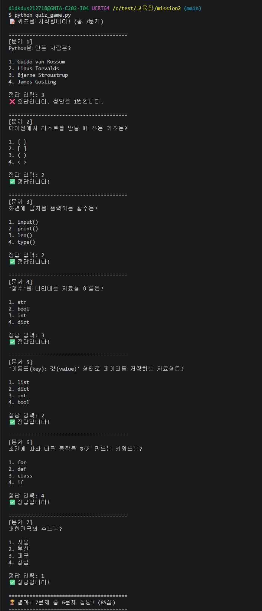
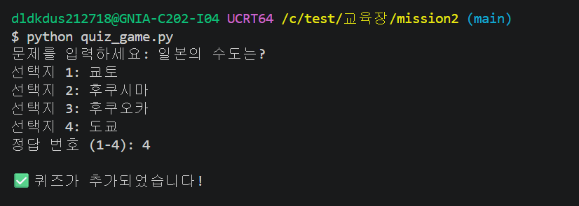
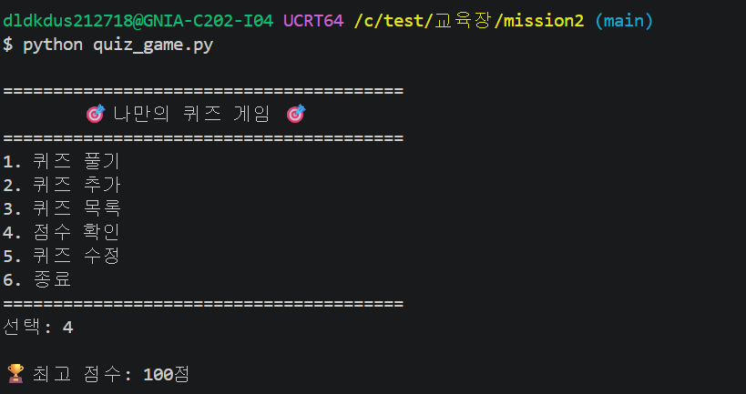
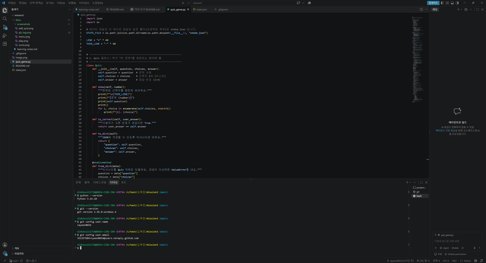
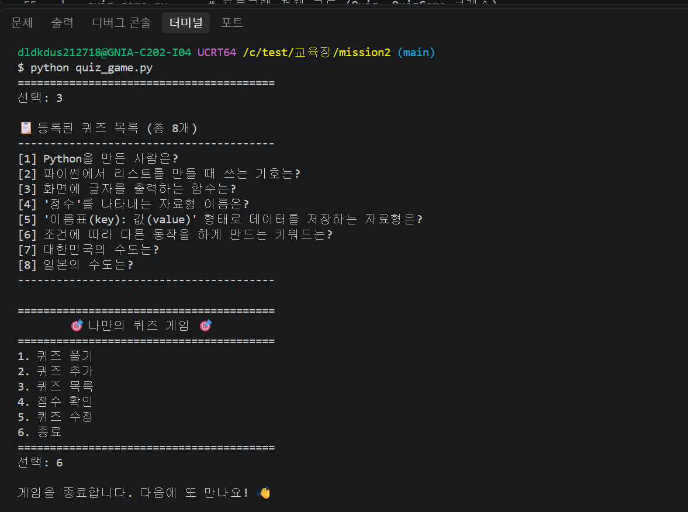

# 🎯 나만의 퀴즈 게임

터미널에서 동작하는 파이썬 퀴즈 게임입니다.
퀴즈 풀기, 추가, 수정, 목록 보기, 최고 점수 확인을 할 수 있고, 프로그램을 종료해도 데이터가 `state.json`에 저장되어 유지됩니다.

## 1. 프로젝트 개요

- 파이썬 기본 문법(변수, 조건문, 반복문, 함수)과 클래스(객체 지향)로 만든 콘솔 프로그램입니다.
- `Quiz` 클래스(퀴즈 한 문제)와 `QuizGame` 클래스(게임 전체 관리)로 역할을 나눴습니다.
- JSON 파일로 데이터를 저장해서, 껐다 켜도 추가한 퀴즈와 최고 점수가 남습니다.
- Git으로 기능 단위 커밋을 남기고, 브랜치를 나눠 작업한 뒤 병합했습니다.
- 외부 라이브러리 없이 파이썬 표준 라이브러리(`json`, `os`)만 사용합니다.

## 2. 퀴즈 주제와 선정 이유

- **주제: 파이썬 기초**
- **선정 이유:** 이 미션을 하면서 배운 파이썬 개념(자료형, 리스트, 딕셔너리, 조건문 등)을 퀴즈로 만들면 복습도 되고, 게임을 만들면서 동시에 공부한 내용을 점검할 수 있기 때문입니다.

## 3. 실행 방법

### 준비물
- Python 3.10 이상
- Git

### 실행
```bash
git clone <저장소 URL>
cd <저장소 폴더>
python quiz_game.py
```

> 윈도우에서 `python`이 안 되면 `py quiz_game.py`, 맥/리눅스에서는 `python3 quiz_game.py`를 사용하세요.

## 4. 기능 목록

| 메뉴 | 기능 | 설명 |
| :--- | :--- | :--- |
| 1 | 퀴즈 풀기 | 저장된 퀴즈를 차례로 출제하고 정답/오답을 알려준 뒤 점수(100점 만점)를 보여줍니다. |
| 2 | 퀴즈 추가 | 문제, 선택지 4개, 정답 번호를 입력받아 저장합니다. |
| 3 | 퀴즈 목록 | 등록된 퀴즈의 문제 목록을 보여줍니다. |
| 4 | 점수 확인 | 지금까지의 최고 점수를 보여줍니다. |
| 5 | 퀴즈 수정 | 원하는 퀴즈의 문제, 선택지, 정답을 바꿉니다. (Enter만 누르면 기존 값 유지) |
| 6 | 종료 | 데이터를 저장하고 종료합니다. |

### 입력/예외 처리
- 입력 앞뒤 공백을 제거합니다. (예: ` 1 ` → `1`)
- 숫자가 아닌 입력(`abc`), 범위 밖 숫자(`9`, `0`), 빈 입력(Enter)은 안내 메시지 후 다시 입력받습니다.
- `Ctrl+C`(KeyboardInterrupt)나 입력 종료(EOFError)가 발생해도 에러로 죽지 않고, 저장 후 안전하게 종료합니다.
- `state.json`이 없으면 기본 퀴즈로 시작하고, 파일이 손상되었으면 안내 메시지를 보여준 뒤 기본 퀴즈로 복구합니다.

## 5. 파일 구조

```
.
├── quiz_game.py      # 프로그램 전체 코드 (Quiz, QuizGame 클래스)
├── state.json        # 퀴즈와 최고 점수 저장 파일 (실행 시 자동 생성)
├── README.md         # 프로젝트 설명서
├── .gitignore        # Git이 추적하지 않을 파일 목록
└── docs/
    └── screenshots/  # 실행 화면 스크린샷
```

### 코드 구조 (quiz_game.py)

| 구성 요소 | 역할 |
| :--- | :--- |
| `Quiz` 클래스 | 퀴즈 한 문제(문제, 선택지 4개, 정답 번호)를 표현하고, 출력/정답 확인/저장용 변환을 담당 |
| `QuizGame` 클래스 | 메뉴, 퀴즈 풀기/추가/수정/목록/점수, 파일 저장과 불러오기를 담당 |
| `read_int`, `read_text` 등 | 공백 제거, 숫자 변환, 범위 검사, 빈 입력 처리를 하는 입력 도우미 함수 |
| `make_default_quizzes()` | 처음 실행할 때 사용하는 기본 퀴즈 6개 |

## 6. 데이터 파일 설명 (`state.json`)

- **경로:** 프로젝트 루트의 `state.json` (`quiz_game.py`와 같은 폴더)
- **인코딩:** UTF-8
- **역할:** 프로그램을 종료해도 퀴즈 목록과 최고 점수가 유지되도록 저장합니다.
- **자동 처리:** 파일이 없으면 기본 퀴즈로 시작하고, 손상되었으면 기본 퀴즈로 복구합니다.

### 스키마

```json
{
    "quizzes": [
        {
            "question": "Python을 만든 사람은?",
            "choices": ["Guido van Rossum", "Linus Torvalds", "Bjarne Stroustrup", "James Gosling"],
            "answer": 1
        }
    ],
    "best_score": 83
}
```

| 키 | 타입 | 설명 |
| :--- | :--- | :--- |
| `quizzes` | 리스트 | 퀴즈 목록 |
| `quizzes[].question` | 문자열 | 문제 내용 |
| `quizzes[].choices` | 문자열 4개짜리 리스트 | 선택지 |
| `quizzes[].answer` | 정수 (1~4) | 정답 번호 |
| `best_score` | 정수 또는 `null` | 최고 점수 (100점 만점, 아직 안 풀었으면 `null`) |

## 7. 실행 화면

| 메뉴 | 퀴즈 풀기 |
| :---: | :---: |
|  |  |

| 퀴즈 추가 | 점수 확인 |
| :---: | :---: |
|  |  |

## 8. git 개발 환경

- 에디터: VSCode
- Python 3.14.10
- Git 2.56.0



## 9. 사용한 Git 명령어

`init` · `add` · `commit` · `push` · `pull` · `checkout` · `merge` · `clone`

- 기능별로 커밋하고, `feature/...` 브랜치에서 작업한 뒤 `main`에 병합했습니다.
- 커밋 메시지는 `Feat:`, `Fix:`, `Docs:`, `Refactor:` 형식으로 작업 내용을 적었습니다.

## 10. 기능 요구사항 달성 현황

| 요구사항 | 구현 내용 | 코드 위치 |
| :--- | :--- | :--- |
| Git 저장소 설정 | GitHub 저장소 생성, `.gitignore`·`README.md` 작성, 첫 `commit`과 `push` | - |
| 메뉴 기능 | 메뉴 출력, 번호 선택, 종료, 잘못된 입력 처리 | `QuizGame.show_menu`, `QuizGame.run` |
| 공통 입력 처리 | 앞뒤 공백 제거, 숫자 변환 실패(`abc`), 범위 밖 숫자(`9`, `0`), 빈 입력(Enter) 처리 후 재입력 | `read_int`, `read_text` |
| 안전한 종료 | `Ctrl+C`(KeyboardInterrupt), 입력 종료(EOFError)가 나도 저장 후 종료 | `QuizGame.run`의 `try/except` |
| 데이터 파일 예외 처리 | 파일이 없으면 기본 퀴즈로 시작, 손상되었으면 안내 후 기본 퀴즈로 복구 | `QuizGame.load_state` |
| `Quiz` 클래스 | 문제(`question`), 선택지 4개(`choices`), 정답(`answer`) 속성과 출력·정답 확인 메서드 | `Quiz.show`, `Quiz.is_correct` |
| 기본 퀴즈 데이터 | 파이썬 기초 퀴즈 6개를 `Quiz` 객체로 생성 | `make_default_quizzes` |
| 퀴즈 풀기 | 문제 출제, 정답 입력, 정답/오답 안내, 결과 표시, 퀴즈가 없는 경우 처리 | `QuizGame.play_quiz` |
| 퀴즈 추가 | 문제·선택지 4개·정답 번호 입력, 잘못된 입력 처리, 파일에 저장 | `QuizGame.add_quiz` |
| 퀴즈 목록 | 저장된 퀴즈 목록 출력, 퀴즈가 없는 경우 처리 | `QuizGame.show_quiz_list` |
| 점수 확인 | 최고 점수 확인, 풀 때마다 비교해 갱신하고 파일에 저장, 아직 안 풀었을 때 처리 | `QuizGame.show_best_score`, `QuizGame.play_quiz` |
| `QuizGame` 클래스 | 퀴즈 목록과 최고 점수를 관리하고 메뉴·풀기·추가·목록·점수·저장을 담당 | `QuizGame` |
| 파일 저장/불러오기 | `state.json`에 UTF-8로 저장하고 불러오기 | `QuizGame.save_state`, `QuizGame.load_state` |
| README 작성 | 개요, 주제 선정 이유, 실행 방법, 기능 목록, 파일 구조, `state.json` 설명 | `README.md` |
| Git 저장소 복제 실습 | 별도 폴더에 `clone`, 복제본에서 수정 후 `commit`·`push`, 원래 폴더에서 `pull` | - |

### 추가로 구현한 기능

- **퀴즈 수정** (`QuizGame.edit_quiz`): 등록된 퀴즈의 문제, 선택지, 정답을 바꿀 수 있습니다. 그냥 Enter를 누르면 기존 값이 유지됩니다.

### 퀴즈 목록 실행 화면



## 11. 과제 목표: 학습한 내용 정리

### Python 기초

- **변수**: 값에 이름을 붙여 저장하는 공간입니다. 값을 여러 번 쓰거나 중간에 바꿔야 할 때 필요합니다. (예: `correct`는 맞힌 개수를 세는 변수)
- **자료형**
  - `int`: 정수 (정답 번호, 점수)
  - `str`: 문자열 (문제, 선택지)
  - `bool`: 참/거짓 (`is_correct`가 돌려주는 값)
  - `list`: 순서가 있는 여러 값의 모음 (`choices`, `quizzes`)
  - `dict`: `이름표: 값` 형태의 모음 (`to_dict`로 만든 퀴즈 한 개)
- **`if/elif/else`**: 조건에 따라 다른 동작을 합니다. 메뉴 번호에 따라 풀기·추가·목록 등을 실행합니다. (`QuizGame.run`)
- **`for`와 `while`**: `for`는 횟수가 정해진 반복에 씁니다. (퀴즈를 하나씩 출제) `while`은 조건이 맞을 때까지 반복할 때 씁니다. (올바른 입력이 들어올 때까지 다시 물어보기, 종료를 고를 때까지 메뉴 반복)
- **함수**: 같은 일을 묶어 이름을 붙인 것입니다. 매개변수로 값을 받고 반환값으로 결과를 돌려줍니다. (예: `read_int(prompt, low, high)`는 범위 안의 숫자를 돌려줍니다.)

### 클래스와 객체

- **클래스**는 설계도이고, **객체**는 그 설계도로 만든 실제 물건입니다. `Quiz`는 설계도, 퀴즈 한 문제가 객체입니다. 데이터와 기능을 하나로 묶어 관리하려고 사용합니다.
- **`__init__`**: 객체를 만들 때 맨 처음 자동으로 실행되어 속성의 초기값을 정합니다.
- **`self`**: 그 객체 자기 자신을 가리킵니다. `self.question`처럼 써서 "이 객체의 문제"를 뜻합니다.
- **속성과 메서드**: 속성은 객체가 가진 값(`question`, `choices`, `answer`)이고, 메서드는 객체가 하는 일(`show`, `is_correct`)입니다.

### 파일 입출력

- **기본 과정**: 파일을 열고(`open`), 읽거나 쓰고, 닫습니다. `with open(...)`을 쓰면 블록이 끝날 때 자동으로 닫힙니다.
- **JSON**: 데이터를 글자로 표현하는 형식입니다. 사람이 읽기 쉽고 파이썬의 `list`·`dict`와 모양이 비슷해서, 프로그램을 꺼도 퀴즈와 점수를 `state.json`에 남기는 데 사용했습니다.
- **`try/except`**: 오류가 나도 프로그램이 죽지 않고 안내 메시지를 보여 주며 이어가게 합니다. 숫자가 아닌 입력(`ValueError`), 파일이 없거나 손상된 경우, `Ctrl+C`에 사용했습니다.

### Git 기초

- **Git**은 파일의 변경 이력을 기록하는 도구입니다. 이전 상태로 돌아갈 수 있고, 여러 사람이 함께 작업할 때 꼭 필요합니다.

| 명령어 | 하는 일 |
| :--- | :--- |
| `init` | 현재 폴더를 Git 저장소로 만듭니다. |
| `add` | 기록(커밋)할 파일을 담습니다. |
| `commit` | 담은 변경 내용을 메시지와 함께 기록합니다. |
| `push` | 내 컴퓨터의 기록을 GitHub에 올립니다. |
| `pull` | GitHub의 새 기록을 내 컴퓨터로 가져옵니다. |
| `checkout` | 브랜치를 옮기거나 만듭니다. (`checkout -b 이름`) |
| `clone` | GitHub 저장소를 내 컴퓨터에 통째로 복제합니다. |

- **브랜치 생성과 병합**: `feature/quiz-class` 브랜치를 만들어 작업한 뒤 `main`으로 돌아와 `merge`했습니다.
- **`clone`과 `pull`**: 저장소를 별도 폴더(`quiz-clone`)에 `clone`하고, 복제본에서 README를 수정해 `push`한 뒤, 원래 폴더에서 `pull`로 변경 사항을 가져왔습니다.

## 12. 보너스 과제 (선택)

이번에는 선택 과제를 구현하지 않았습니다. 이후 개선할 때 도전해 볼 목록입니다.

| 보너스 과제 | 상태 |
| :--- | :--- |
| 랜덤 출제 | 미구현 |
| 문제 수 선택 | 미구현 |
| 힌트 기능 | 미구현 |
| 퀴즈 삭제 기능 | 미구현 |
| 점수 기록 히스토리 | 미구현 |
