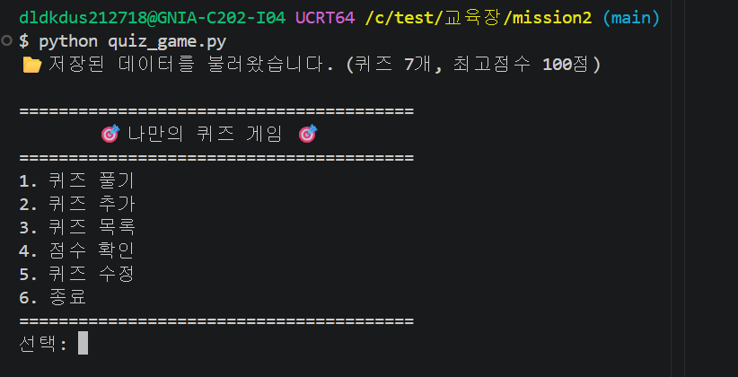

# 🎯 나만의 퀴즈 게임

터미널에서 동작하는 파이썬 퀴즈 게임입니다.
퀴즈 풀기, 추가, 수정, 목록 보기, 최고 점수 확인을 할 수 있고, 프로그램을 종료해도 데이터가 `state.json`에 저장되어 유지됩니다.

## 1. 프로젝트 개요

- 파이썬 기본 문법(변수, 조건문, 반복문, 함수)과 클래스(객체 지향)로 만든 콘솔 프로그램입니다.
- `Quiz` 클래스(퀴즈 한 문제)와 `QuizGame` 클래스(게임 전체 관리)로 역할을 나눴습니다.
- JSON 파일로 데이터를 저장해서, 껐다 켜도 추가한 퀴즈와 최고 점수가 남습니다.
- Git으로 기능 단위 커밋을 남기고, 브랜치를 나눠 작업한 뒤 병합했습니다.
- 외부 라이브러리 없이 파이썬 표준 라이브러리(`json`, `os`)만 사용합니다.

## 2. 퀴즈 주제와 선정 이유

- **주제: 파이썬 기초**
- **선정 이유:** 이 미션을 하면서 배운 파이썬 개념(자료형, 리스트, 딕셔너리, 조건문 등)을 퀴즈로 만들면 복습도 되고, 게임을 만들면서 동시에 공부한 내용을 점검할 수 있기 때문입니다.

## 3. 실행 방법

### 준비물
- Python 3.10 이상
- Git

### 실행
```bash
git clone <저장소 URL>
cd <저장소 폴더>
python quiz_game.py
```

> 윈도우에서 `python`이 안 되면 `py quiz_game.py`, 맥/리눅스에서는 `python3 quiz_game.py`를 사용하세요.

## 4. 기능 목록

| 메뉴 | 기능 | 설명 |
| :--- | :--- | :--- |
| 1 | 퀴즈 풀기 | 저장된 퀴즈를 차례로 출제하고 정답/오답을 알려준 뒤 점수(100점 만점)를 보여줍니다. |
| 2 | 퀴즈 추가 | 문제, 선택지 4개, 정답 번호를 입력받아 저장합니다. |
| 3 | 퀴즈 목록 | 등록된 퀴즈의 문제 목록을 보여줍니다. |
| 4 | 점수 확인 | 지금까지의 최고 점수를 보여줍니다. |
| 5 | 퀴즈 수정 | 원하는 퀴즈의 문제, 선택지, 정답을 바꿉니다. (Enter만 누르면 기존 값 유지) |
| 6 | 종료 | 데이터를 저장하고 종료합니다. |

### 입력/예외 처리
- 입력 앞뒤 공백을 제거합니다. (예: ` 1 ` → `1`)
- 숫자가 아닌 입력(`abc`), 범위 밖 숫자(`9`, `0`), 빈 입력(Enter)은 안내 메시지 후 다시 입력받습니다.
- `Ctrl+C`(KeyboardInterrupt)나 입력 종료(EOFError)가 발생해도 에러로 죽지 않고, 저장 후 안전하게 종료합니다.
- `state.json`이 없으면 기본 퀴즈로 시작하고, 파일이 손상되었으면 안내 메시지를 보여준 뒤 기본 퀴즈로 복구합니다.

## 5. 파일 구조

```
.
├── quiz_game.py      # 프로그램 전체 코드 (Quiz, QuizGame 클래스)
├── state.json        # 퀴즈와 최고 점수 저장 파일 (실행 시 자동 생성)
├── README.md         # 프로젝트 설명서
├── .gitignore        # Git이 추적하지 않을 파일 목록
└── docs/
    └── screenshots/  # 실행 화면 스크린샷
```

### 코드 구조 (quiz_game.py)

| 구성 요소 | 역할 |
| :--- | :--- |
| `Quiz` 클래스 | 퀴즈 한 문제(문제, 선택지 4개, 정답 번호)를 표현하고, 출력/정답 확인/저장용 변환을 담당 |
| `QuizGame` 클래스 | 메뉴, 퀴즈 풀기/추가/수정/목록/점수, 파일 저장과 불러오기를 담당 |
| `read_int`, `read_text` 등 | 공백 제거, 숫자 변환, 범위 검사, 빈 입력 처리를 하는 입력 도우미 함수 |
| `make_default_quizzes()` | 처음 실행할 때 사용하는 기본 퀴즈 6개 |

## 6. 데이터 파일 설명 (`state.json`)

- **경로:** 프로젝트 루트의 `state.json` (`quiz_game.py`와 같은 폴더)
- **인코딩:** UTF-8
- **역할:** 프로그램을 종료해도 퀴즈 목록과 최고 점수가 유지되도록 저장합니다.
- **자동 처리:** 파일이 없으면 기본 퀴즈로 시작하고, 손상되었으면 기본 퀴즈로 복구합니다.

### 스키마

```json
{
    "quizzes": [
        {
            "question": "Python을 만든 사람은?",
            "choices": ["Guido van Rossum", "Linus Torvalds", "Bjarne Stroustrup", "James Gosling"],
            "answer": 1
        }
    ],
    "best_score": 83
}
```

| 키 | 타입 | 설명 |
| :--- | :--- | :--- |
| `quizzes` | 리스트 | 퀴즈 목록 |
| `quizzes[].question` | 문자열 | 문제 내용 |
| `quizzes[].choices` | 문자열 4개짜리 리스트 | 선택지 |
| `quizzes[].answer` | 정수 (1~4) | 정답 번호 |
| `best_score` | 정수 또는 `null` | 최고 점수 (100점 만점, 아직 안 풀었으면 `null`) |

## 7. 실행 화면

| 메뉴 | 퀴즈 풀기 |
| :---: | :---: |
|  |  |

| 퀴즈 추가 | 점수 확인 |
| :---: | :---: |
|  |  |

## 8. 사용한 Git 명령어

`init` · `add` · `commit` · `push` · `pull` · `checkout` · `merge` · `clone`

- 기능별로 커밋하고, `feature/...` 브랜치에서 작업한 뒤 `main`에 병합했습니다.
- 커밋 메시지는 `Feat:`, `Fix:`, `Docs:`, `Refactor:` 형식으로 작업 내용을 적었습니다.
