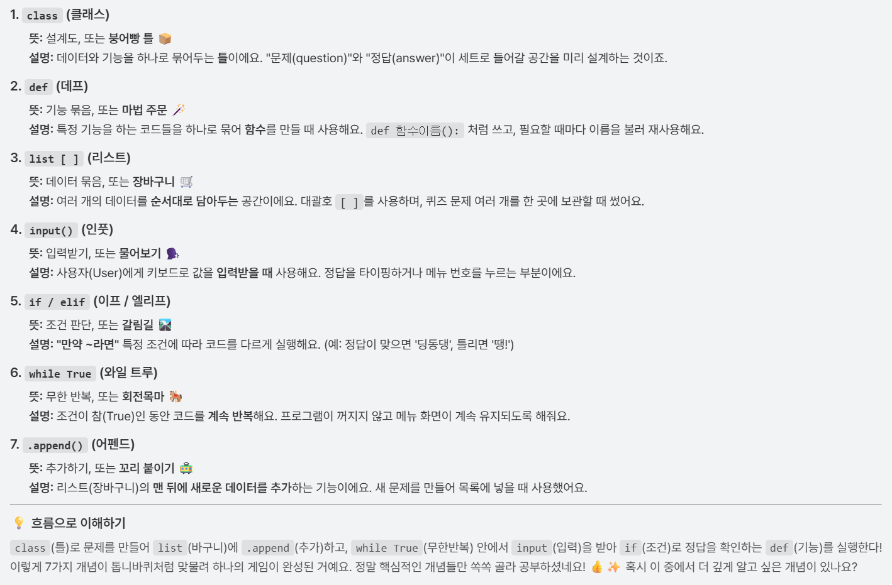

# Mission 2 시작

# 🎮 미션 2: 나만의 퀴즈 게임 만들기

## 1. 이번 미션은 무엇을 하는 건가요? 🚀
한마디로 말하면 **"파이썬으로 똑똑한 퀴즈 박사님 만들기"**예요. 
단순히 문제를 푸는 것뿐만 아니라, 내가 문제를 직접 추가할 수도 있고, 게임을 껐다 켜도 내 점수를 기억하는 아주 똑똑한 프로그램을 만드는 것이 목표예요.

---

## 2. 우리가 배워야 할 핵심 개념 💡

*   **① 클래스 (Class) : "붕어빵 틀"**
    *   **설명:** 퀴즈 하나하나를 만들 때마다 똑같은 코드를 계속 쓰면 힘들겠죠? 그래서 '퀴즈'라는 틀을 하나 만들어두는 거예요.
    *   **역할:** 이 틀에는 '문제', '보기 4개', '정답 번호'가 들어갈 자리가 미리 정해져 있어요.

*   **② JSON (제이슨) : "비밀 일기장"**
    *   **설명:** 컴퓨터는 게임을 끄면 모든 걸 까먹어요. 그래서 게임을 끄기 전에 JSON이라는 일기장에 기록을 남겨요.
    *   **역할:** 다음에 게임을 켤 때 이 일기장을 읽어서 예전 점수와 문제를 다시 불러와요.

*   **③ 예외 처리 (Try/Except) : "실수 방패"**
    *   **설명:** 숫자를 입력해야 하는데 문자를 입력하면 프로그램이 멈춰버려요. 이때 "당황하지 마! 다시 입력해줘"라고 알려주는 방패예요.

*   **④ Git 브랜치 (Branch) : "평행 우주"**
    *   **설명:** 원래 만들던 게임을 망치지 않게 복사본 우주를 만들어 거기서 새로운 기능을 테스트해요. 잘 되면 나중에 합쳐요!

---

## 3. 미션 성공을 위해 해야 할 일들 📝

1.  **메뉴 만들기**: 사용자가 번호를 골라 기능을 선택하는 화면을 만들어요.
2.  **퀴즈 틀(클래스) 만들기**: 문제와 정답을 담을 수 있는 주머니를 만들어요.
3.  **저장 기능 만들기**: 점수와 문제를 `state.json` 파일에 저장하고 불러와요.
4.  **Git으로 기록하기**: 기능을 만들 때마다 깃허브에 도장을 찍어요. (최소 10번 이상!)
5.  **설명서 작성**: 이 게임이 어떤 게임인지 멋지게 적어주면 끝!

## 💡 코드 설명 (학생을 위한 팁!)
1.  while True:: 이 코드는 "내가 그만하라고 할 때까지 계속 반복해!"라는 뜻이에요. 덕분에 메뉴가 한 번 나오고 끝나는 게 아니라 계속 나타나게 됩니다.
2.  input(): 사용자가 키보드로 입력한 값을 받아오는 함수예요.
3.  break: 3번을 눌렀을 때 while 반복문을 멈추고 게임을 끝내주는 아주 중요한 역할을 해요.

```bash
def main_menu():
    while True:
        print("\n--- 🎮 퀴즈 게임 메뉴 ---")
        print("1. 퀴즈 풀기")
        print("2. 문제 추가하기")
        print("3. 종료")
        
        choice = input("원하는 메뉴 번호를 입력하세요: ")

        if choice == '1':
            print("\n[알림] 아직 퀴즈 기능이 준비되지 않았어요!")
        elif choice == '2':
            print("\n[알림] 아직 문제 추가 기능이 준비되지 않았어요!")
        elif choice == '3':
            print("\n게임을 종료합니다. 다음에 또 만나요! 👋")
            break  # 반복문을 빠져나가서 프로그램을 종료해요.
        else:
            print("\n[경고] 1, 2, 3 중에서만 골라주세요!")

# 이 프로그램이 실행될 때 main_menu 함수를 실행시켜요.
if __name__ == "__main__":
    main_menu()
```

## 💡 코드 설명
```
# 1. 퀴즈 문제의 틀(클래스)을 만들어요.
class Question:
    def __init__(self, text, answer):
        self.text = text      # 문제 내용
        self.answer = answer  # 정답

# --- 기존 코드 (main_menu 함수 등) ---
def main_menu():
    # ... (생략)
    
```
1.  class Question:: 이제부터 Question이라는 이름의 붕어빵 틀을 만들겠다는 뜻이에요.
2.  __init__: 붕어빵을 처음 구울 때(객체를 만들 때) 문제 내용과 정답을 넣어서 초기화해주는 특수한 함수예요.
3.  self.text, self.answer: 각 문제마다 자기만의 질문과 답을 저장하는 저장 공간이에요.

## 💡 팁
1.  파이썬은 들여쓰기로 "이 코드가 함수 안에 포함된 건지 아닌지"를 구별해요.
2.  def, if, while 처럼 끝에 콜론(:)이 붙는 문장 바로 다음 줄은 무조건 들여쓰기를 해야 한다고 기억하면 쉬워요!

```bash
def main_menu():
    # 여기서부터는 Tab을 눌러서 안으로 들여써야 해요!
    while True:
        print("\n--- 🎮 퀴즈 게임 메뉴 ---")
        print("1. 퀴즈 풀기")
        print("2. 문제 추가하기")
        print("3. 종료")
        
        choice = input("원하는 메뉴 번호를 입력하세요: ")

        if choice == '1':
            print("\n[알림] 아직 퀴즈 기능이 준비되지 않았어요!")
        elif choice == '2':
            print("\n[알림] 아직 문제 추가 기능이 준비되지 않았어요!")
        elif choice == '3':
            print("\n게임을 종료합니다. 다음에 또 만나요! 👋")
            break
        else:
            print("\n[경고] 1, 2, 3 중에서만 골라주세요!")

# 함수가 끝났으므로 여기는 다시 맨 앞으로 붙여서 써요 (들여쓰기 X)
if __name__ == "__main__":
    main_menu()
```

## 💡 요약하자면?
1.  class와 def: "이런 도구를 만들 거야"라고 미리 알려주는 부분 (위쪽)
2.  if __name__ == "__main__":: "이제 진짜 시작해!"라고 버튼을 누르는 부분 (맨 아래쪽)

```bash
# 1. 클래스 정의 (붕어빵 틀)
class Question:
    def __init__(self, text, answer):
        self.text = text
        self.answer = answer

# 2. 함수 정의 (기능 설명)
def main_menu():
    while True:
        print("\n--- 🎮 퀴즈 게임 메뉴 ---")
        print("1. 퀴즈 풀기")
        print("2. 문제 추가하기")
        print("3. 종료")
        
        choice = input("원하는 메뉴 번호를 입력하세요: ")

        if choice == '1':
            print("\n[알림] 아직 퀴즈 기능이 준비되지 않았어요!")
        elif choice == '2':
            print("\n[알림] 아직 문제 추가 기능이 준비되지 않았어요!")
        elif choice == '3':
            print("\n게임을 종료합니다. 다음에 또 만나요! 👋")
            break
        else:
            print("\n[경고] 1, 2, 3 중에서만 골라주세요!")

# 3. 실제 실행 (맨 마지막에!)
if __name__ == "__main__":
    main_menu()

```

## 🛠️ 3단계: 진짜 퀴즈 문제 만들고 풀기
이제 메뉴만 있는 껍데기에서 벗어나, 진짜 퀴즈를 풀 수 있게 만들어볼까요?

1.  퀴즈 문제 리스트 만들기
main_menu() 함수 바로 위에, 우리가 만든 Question 클래스를 사용해서 문제 리스트를 만들어줍니다.

2.  퀴즈 풀기 함수(run_quiz) 만들기
문제를 하나씩 보여주고 정답을 맞혔는지 확인하는 기능을 만들 거예요.

quiz_game.py 파일을 아래와 같이 업데이트해 보세요. (기존 코드를 참고해서 추가/수정하시면 됩니다!)

```bash
# ... (Question 클래스는 그대로 두세요)

# 1. 퀴즈 문제들을 리스트에 담아둡니다.
questions_list = [
    Question("대한민국의 수도는?", "서울"),
    Question("파이썬을 만든 사람은 귀도 반 ( )?", "로섬"),
    Question("사과를 영어로 하면?", "apple")
]

# 2. 퀴즈를 진행하는 함수를 만들어요.
def run_quiz(questions):
    score = 0
    print(f"\n총 {len(questions)}문제를 시작합니다!")
    
    for q in questions:
        answer = input(f"{q.text} 정답 입력: ")
        if answer.strip() == q.answer:  # strip()은 양쪽 공백을 제거해줘요
            print("정답입니다! ✨")
            score += 1
        else:
            print(f"아쉽네요. 정답은 '{q.answer}'입니다. 😢")
            
    print(f"\n--- 퀴즈 종료! ---")
    print(f"당신의 점수: {score} / {len(questions)}")

# 3. main_menu 함수에서 1번을 눌렀을 때 run_quiz를 실행하게 수정해요.
def main_menu():
    while True:
        # ... (메뉴 출력 부분 생략)
        choice = input("원하는 메뉴 번호를 입력하세요: ")

        if choice == '1':
            run_quiz(questions_list)  # 퀴즈 시작!
        elif choice == '2':
            print("\n[알림] 아직 문제 추가 기능은 준비 중이에요!")
        # ... (나머지 동일)

```

## 💡 무엇이 달라졌나요?
1.   questions_list 추가: 퀴즈 문제 3개를 미리 만들어 두었습니다.
2.   run_quiz 함수 추가: 문제를 하나씩 보여주고, 사용자의 입력을 받아 정답인지 확인하는 '진짜 게임 로직'이 들어갔어요.
3.   순서 정리: 파이썬은 위에서 아래로 읽기 때문에, 도구(함수)를 먼저 정의하고 **마지막에 실행(main_menu)**하도록 순서를 맞췄습니다.

```bash
# 1. 클래스 정의 (문제의 틀)
class Question:
    def __init__(self, text, answer):
        self.text = text
        self.answer = answer

# 2. 퀴즈 문제 리스트 (미리 만들어둔 문제들)
questions_list = [
    Question("대한민국의 수도는?", "서울"),
    Question("파이썬을 만든 사람은 귀도 반 ( )?", "로섬"),
    Question("사과를 영어로 하면?", "apple")
]

# 3. 퀴즈를 풀게 해주는 함수 (기능)
def run_quiz(questions):
    score = 0
    print(f"\n총 {len(questions)}문제를 시작합니다!")
    
    for q in questions:
        answer = input(f"\n{q.text} 정답 입력: ")
        # .strip()은 혹시 모를 앞뒤 공백을 지워줘요!
        if answer.strip() == q.answer:
            print("정답입니다! ✨")
            score += 1
        else:
            print(f"아쉽네요. 정답은 '{q.answer}'입니다. 😢")
            
    print(f"\n--- 퀴즈 종료! ---")
    print(f"당신의 점수: {score} / {len(questions)}")

# 4. 메뉴 화면 함수
def main_menu():
    while True:
        print("\n--- 🎮 퀴즈 게임 메뉴 ---")
        print("1. 퀴즈 풀기")
        print("2. 문제 추가하기")
        print("3. 종료")
        
        choice = input("원하는 메뉴 번호를 입력하세요: ")

        if choice == '1':
            # 여기서 위에서 만든 run_quiz 함수를 실행해요!
            run_quiz(questions_list)
        elif choice == '2':
            print("\n[알림] 아직 문제 추가 기능은 준비 중이에요!")
        elif choice == '3':
            print("\n게임을 종료합니다. 다음에 또 만나요! 👋")
            break
        else:
            print("\n[경고] 1, 2, 3 중에서만 골라주세요!")

# 5. 프로그램 시작점
if __name__ == "__main__":
    main_menu()
```

## 🛠️ 4단계: 문제 추가 기능 만들기
run_quiz 함수 아래에 새로운 문제를 리스트에 추가하는 add_question 함수를 만들어 봅시다.

1. add_question 함수 추가하기
->run_quiz 함수가 끝나는 지점 다음에 아래 코드를 넣어주세요.

```bash
def add_question():
    print("\n--- ➕ 새로운 문제 추가 ---")
    text = input("문제 내용을 입력하세요: ")
    answer = input("정답을 입력하세요: ")
    
    # 새로운 Question 객체를 만들어서 리스트에 추가(append)해요!
    new_q = Question(text, answer)
    questions_list.append(new_q)
    
    print("\n[성공] 문제가 리스트에 추가되었습니다! ✅")
```

2. main_menu에서 2번 선택 시 연결하기
기존에 print("[알림] 아직 준비 중...")이었던 부분을 방금 만든 함수로 바꿔줍니다.

```bash
        elif choice == '2':
            add_question()  # 문제 추가 함수 실행!
```

💡 여기서 잠깐! (중요한 개념)
questions_list.append(new_q): append는 리스트의 맨 뒤에 새로운 데이터를 붙이는 명령어예요. 마치 기차 뒤에 새로운 칸을 하나 더 연결하는 것과 같죠! 🚂


## 아하, 이 에러는 파이썬에서 가장 자주 만나는 '들여쓰기(Indentation)' 문제예요! 😅

사진을 자세히 보니 elif choice == '3': 부분과 그 아래 else: 부분이 앞으로 너무 많이 들어가 있거나, 줄이 맞지 않아서 발생한 에러입니다. 파이썬은 줄 맞추기에 아주 예민하거든요.

🛠️ 해결 방법
main_menu 함수 안의 if-elif-else 줄을 똑같이 맞춰줘야 합니다. 아래 그림처럼 if, elif, else가 수직으로 딱 맞아야 해요.

[수정 전 (현재 상태)]
```bash
        if choice == '1':
            run_quiz(questions_list)
        elif choice == '2':
            add_question()
          elif choice == '3':  # 👈 여기가 더 들어가 있거나 줄이 안 맞아요!
              break
            else:              # 👈 여기도 줄이 안 맞아요!
```

[수정 후 (이렇게 맞춰주세요!)]
```bash
        if choice == '1':
            run_quiz(questions_list)
        elif choice == '2':
            add_question()
        elif choice == '3':  # 👈 if, elif 들과 세로줄을 똑같이!
            print("\n게임을 종료합니다. 다음에 또 만나요! 👋")
            break
        else:                # 👈 여기도 세로줄을 똑같이!
            print("\n[경고] 1, 2, 3 중에서만 골라주세요!")
```

## Python 개념 정리
# 🐍 Python Quiz Game Project

파이썬의 기초 핵심 개념들을 활용하여 만든 **퀴즈 게임 프로그램**입니다. 
코드를 작성하며 학습한 주요 개념들을 비유를 통해 정리했습니다.

## 💡 Python 핵심 개념 정리

| 개념 | 비유 | 설명 (Project 활용) |
| :--- | :--- | :--- |
| **class** | 🍞 **붕어빵 틀** | `Question` 클래스를 만들어 문제와 정답이 들어갈 구조를 설계했습니다. |
| **def** | 🪄 **마법 주문** | `run_quiz()`, `add_question()` 등 반복되는 기능을 주문처럼 묶어 정의했습니다. |
| **list [ ]** | 🛒 **장바구니** | `questions_list`라는 바구니에 여러 개의 퀴즈 객체들을 담아 관리했습니다. |
| **input()** | 🗣️ **물어보기** | 사용자에게 정답이나 메뉴 번호를 입력받아 소통하는 창구로 사용했습니다. |
| **if / elif** | 🛣️ **갈림길** | 사용자가 입력한 번호에 따라 게임을 시작하거나 종료하는 경로를 나눴습니다. |
| **while True** | 🎠 **회전목마** | 프로그램이 바로 종료되지 않고 메뉴 화면이 계속 반복해서 나오도록 설정했습니다. |
| **.append()** | 🚃 **꼬리 붙이기** | 사용자가 새로 만든 문제를 기차 칸을 늘리듯 리스트 맨 뒤에 추가했습니다. |

## 추가 정리


## 🎯 오늘의 목표: "문제를 파일에 저장하기"
지금 우리 프로그램에는 아주 아쉬운 점이 하나 있어요. 😢

프로그램을 껐다 켜면, 힘들게 추가한 문제들이 다~ 사라져요!

왜냐하면 지금 문제들은 **'장바구니(리스트)'**에만 담겨있는데, 이 장바구니는 프로그램을 끄면 사라지는 '기억력 나쁜 메모장' 같은 거라서 그래요.

그래서 우리는 문제들을 파일(JSON)에 영구적으로 저장할 거예요!

## 💡 JSON이 뭐예요?
"컴퓨터끼리 쓰는 아주 깔끔한 메모장" 이라고 생각하면 돼요! 📝
우리가 만든 문제(장바구니 내용물)를 파일 하나에 똑같이 베껴 적어두는 거예요.

## 지금 보니 1번 줄(# 1. 클래스 정의)이 코드의 맨 꼭대기예요.
import json은 모든 코드보다 더 위, 즉 1번 줄보다도 위에 넣어주는 게 가장 좋아요.

📍 이렇게 넣어주세요!
**맨 첫 줄(# 1. 클래스 정의 윗줄)**을 새로 만들어서 아래처럼 넣어주세요.

```bash
import json  # 👈 이 줄을 맨 꼭대기에 추가!

# 1. 클래스 정의 (문제의 틀)
class Question:
    def __init__(self, text, answer):
        self.text = text
        self.answer = answer
```

💡 왜 맨 위에 넣어요?
"요리하기 전에 재료와 도구부터 식탁에 꺼내놓기" 와 같아요! 🍳

요리(코드 실행)를 시작하기 전에 필요한 도구(json)를 미리 꺼내놔야, 나중에 "앗! 도구가 없네?" 하고 당황하지 않거든요. 그래서 도구를 가져오는 import는 항상 맨 위쪽에 모아두는 게 약속이에요.

## 🎯 저장하는 함수 만들기 (save)
우리 목표는 "장바구니(questions_list)에 담긴 문제들을 파일에 베껴 적기" 예요.

그런데 한 가지 문제가 있어요! 😮
우리 문제들은 Question 이라는 '붕어빵' 모양이라서, JSON 메모장에 그대로 적을 수가 없어요. JSON은 글자나 숫자 같은 단순한 것만 적을 수 있거든요.

그래서 붕어빵(객체)을 → 딕셔너리(이름표 붙은 상자) 모양으로 바꿔서 저장할 거예요.

📝 아래 함수를 추가해 주세요
run_quiz 함수가 끝나는 곳(29번 줄) 아래에 넣어주세요.

```bash
# 4. 문제들을 파일에 저장하는 함수
def save_questions(questions):
    # 붕어빵(객체)들을 딕셔너리 목록으로 바꿔 담을 새 장바구니
    data = []
    for q in questions:
        # 문제 하나를 {이름표: 내용} 모양으로 변신시켜요!
        data.append({"text": q.text, "answer": q.answer})

    # 'quiz_data.json' 이라는 파일을 열어서 적어요 (w = write, 쓰기)
    with open("quiz_data.json", "w", encoding="utf-8") as f:
        json.dump(data, f, ensure_ascii=False, indent=4)

    print("💾 문제가 성공적으로 저장되었어요!")
```

## 💡 어려운 부분만 쉽게 풀어볼게요!
| 코드 | 쉬운 뜻 |
| :--- | :--- |
| `open("...", "w")` | 메모장을 **'쓰기 모드'**로 펼치기 📖 |
| `encoding="utf-8"` | 한글이 안 깨지게 하는 마법 주문 🪄 |
| `json.dump()` | 장바구니 내용을 파일에 쏟아붓기 📥 |
| `ensure_ascii=False` | 한글을 한글 그대로 저장하기 🇰🇷 |
| `indent=4` | 보기 좋게 줄맞춤해서 저장하기 📏 |

## 🎯 다음: 불러오는 함수 만들기 (load)
저장했으면 반대로 "파일에 적어둔 문제를 다시 꺼내오는" 기능도 필요하겠죠? 📂

save_questions 함수 아래에 추가해 주세요.

```bash
# 5. 파일에서 문제들을 불러오는 함수
def load_questions():
    try:
        # 파일을 열어서 읽어요 (r = read, 읽기)
        with open("quiz_data.json", "r", encoding="utf-8") as f:
            data = json.load(f)

        # 딕셔너리들을 다시 붕어빵(Question 객체)으로 변신!
        questions = []
        for item in data:
            questions.append(Question(item["text"], item["answer"]))
        return questions

    except FileNotFoundError:
        # 저장된 파일이 없으면 빈 장바구니를 돌려줘요
        print("📂 저장된 파일이 없어서 새로 시작해요!")
        return []
```
## 💾 데이터 저장과 불러오기

| 구분 | 저장 (Save) | 불러오기 (Load) |
| :--- | :--- | :--- |
| **모드** | `"w"` (쓰기) ✍️ | `"r"` (읽기) 👁️ |
| **명령어** | `json.dump` | `json.load` |
| **방향** | 붕어빵 → 딕셔너리 | 딕셔너리 → 붕어빵 |

> 💡 **Tip:** `try / except`는 "혹시 파일이 없으면?" 하고 대비하는 **안전장치**예요. 🚧 처음엔 저장된 파일이 없을 테니까요!

## 이제 두 함수(save, load)를 다 만들었으니, 마지막으로 메뉴와 연결만 하면 완성이에요! 🔗

🎯 마지막 단계: 메뉴와 연결하기
지금 우리 함수들은 만들어만 놓고 아무도 안 쓰는 상태예요. 😅
전화기를 만들었는데 아직 전화번호를 안 누른 셈이죠! 📞

연결할 곳은 2군데예요.

## 1️⃣ 프로그램 시작할 때 → 자동으로 불러오기
메인 실행 부분에서 questions_list를 만드는 곳을 찾아주세요.
아마 이런 식으로 되어 있을 거예요.
```bash
questions_list = [
    Question("...", "..."),
    ...
]
```

이 부분을 아래처럼 바꿔주세요.
```bash
# 프로그램 시작하면 저장된 문제를 자동으로 불러와요!
questions_list = load_questions()
```
💡 이제 프로그램을 켜면 저장해둔 문제를 자동으로 가져와요! 📂

## 2️⃣ 문제 추가한 뒤 → 자동으로 저장하기
문제를 추가하는 부분(questions_list.append(...) 하는 곳)을 찾아서, 바로 아래 줄에 저장 함수를 넣어주세요.
```bash
questions_list.append(new_question)  # (이미 있는 줄)
save_questions(questions_list)       # 👈 이 줄 추가! 바로 저장!
```
💡 새 문제를 만들면 즉시 파일에 저장돼서 안 사라져요! 💾

## 🎯 여기에 넣으세요!
지금 화면에 이 줄이 보이죠?
```bash
questions_list.append(new_q)      # ← 이미 있는 줄 (16번째 줄쯤)
```
바로 이 줄 아래에 한 줄 추가하면 돼요! 👇
```bash
new_q = Question(text, answer)
questions_list.append(new_q)
save_questions(questions_list)        # 👈 이 줄을 새로 추가!

print("\n[성공] 문제가 리스트에 추가되었습니다! ✅")
```
## ⚠️ 중요 포인트 2가지!
1.  들여쓰기 맞추기 📏

    questions_list.append(new_q) 와 똑같이 앞을 띄워야 해요!
    위 줄 맨 앞에 커서를 두고 → 그 자리에서 입력하면 딱 맞아요!

2.  함수 이름 확인 🔍

    저장 함수 이름이 save_questions 가 맞나요?
    전에 만든 함수 이름이랑 똑같아야 해요!

이렇게 하면 문제를 추가할 때마다 자동으로 저장돼요! 💾✨

## 이제 마지막 단계예요! 바로 "불러오기(load)" 연결! 🎉

🎯 왜 불러오기가 필요할까요? 🤔
지금은 문제를 저장(save)은 하는데,
프로그램을 껐다 켜면 저장한 문제를 다시 안 읽어와요! 😱

그래서 프로그램이 시작될 때 "저장된 문제 좀 읽어와!" 하고
명령을 넣어줘야 해요! 📂

🎯 이렇게 넣어보세요!
화면 맨 아래에 이 부분 보이죠?
```bash
# 5. 프로그램 시작점
if __name__ == "__main__":
    main_menu()
```
여기를 이렇게 바꿔주세요! 👇
```bash
# 5. 프로그램 시작점
if __name__ == "__main__":
    questions_list = load_questions()     # 👈 이 줄 추가! (저장된 문제 불러오기)
    main_menu()
```
⚠️ 확인할 점 2가지!
1.  load_questions 이름 맞나요? 🔍

    전에 만든 불러오기 함수 이름이랑 똑같아야 해요!

2.  들여쓰기 📏

    main_menu() 랑 앞 간격을 똑같이 맞춰주세요!

## 🔍 에러 뜻 풀이
```bash
IndentationError: unexpected indent
```
이건 👉 "들여쓰기(띄어쓰기)가 이상해요!" 라는 뜻이에요! 📏

그리고 line 12 라고 나와있죠?
→ 12번째 줄에 문제가 있다는 신호예요! 🎯

🎯 문제의 줄은 여기예요!

```bash
Question("대한민국의 수도는?", "서울"),
```
이 줄 맨 앞에 띄어쓰기(공백)가 들어가 있어요! 😱
그래서 파이썬이 "왜 여기서 갑자기 들여쓰기가 됐지?" 하고 놀란 거예요!

✅ 어떻게 고치나요?
이 줄이 어디 안에 들어있는지에 따라 달라요! 🤔

그래서 12번째 줄 주변을 보여주셔야 정확히 알 수 있어요! 📸

11번째 줄 ~ 14번째 줄 정도를 캡처해서 보여주세요!

💡 보통 이런 경우예요
만약 이렇게 리스트 안에 들어있는 거라면:
```bash
questions_list = [
    Question("대한민국의 수도는?", "서울"),      # 들여쓰기 O (정상)
]
```
👉 이건 정상이에요!

그런데 이렇게 되어 있으면 에러예요:
```bash
    Question("대한민국의 수도는?", "서울"),      # 앞에 공백만 둥둥 (에러!)
```
👉 혼자 떠 있으면 안 돼요!

## 🔍 무슨 일이 일어난 걸까요?
화면을 보면 이렇게 되어 있어요:
```bash
questions_list = load_questions()
    Question("대한민국의 수도는?", "서울"),
    Question("파이썬을 만든 사람은 귀도 반 ( )?", "로섬"),
    Question("사과를 영어로 하면?", "apple")
```
문제가 보이시나요? 🤔

원래 여기는 리스트 [ ] 안에 문제들이 들어있던 자리였어요!
그런데 load_questions() 로 바꾸면서 리스트 대괄호 [ ] 가 사라졌는데,
아래 Question 줄들이 그대로 남아있어서 혼자 떠버린 거예요! 😱

✅ 해결 방법
이제 문제 불러오기를 load_questions()로 하기로 했으니까,
아래에 떠 있는 Question 3줄은 더 이상 필요 없어요! 🗑️

👉 아래 3줄을 삭제하면 돼요!
```bash
    Question("대한민국의 수도는?", "서울"),             # ❌ 삭제
    Question("파이썬을 만든 사람은 귀도 반 ( )?", "로섬"),  # ❌ 삭제
    Question("사과를 영어로 하면?", "apple")             # ❌ 삭제
```
✅ 정리하면 이렇게 돼요!
```bash
# 2. 퀴즈 문제 리스트 (미리 만들어둔 문제들)
# 프로그램 시작하면 저장된 문제를 자동으로 불러와요!
questions_list = load_questions()
```
이렇게 딱 한 줄만 남으면 돼요! ✨

⚠️ 잠깐! 생각해볼 점 🤔
    그런데 이렇게 하면 처음 실행할 때는 저장된 파일이 없어서 문제가 하나도 없을 수도 있어요! 😮


## 🔍 에러 뜻 풀이
```bash
NameError: name 'load_questions' is not defined
```
👉 "load_questions라는 이름을 못 찾겠어요!" 라는 뜻이에요! 🔍

🤔 왜 이런 일이?
파이썬은 코드를 위에서 아래로 순서대로 읽어요! 📖⬇️

그런데 지금은 이런 상황일 가능성이 커요 👇
```bash
questions_list = load_questions()   # 11번째 줄 → 여기서 함수를 부름! 😱

...

def load_questions():               # 아래쪽 → 함수 정의가 여기 있음!
    ...
```
즉, 함수를 정의하기도 전에 먼저 불러서 쓰려고 한 거예요!
파이썬 입장에서는 "그런 이름 아직 못 봤는데요?" 하는 거죠! 🤷

## ✅ 해결 방법
함수들을 먼저 정의하고, 실행은 맨 아래에서! 📏

보통 이렇게 순서를 맞춰요 👇
```bash
# 1. 클래스 정의
class Question:
    ...

# 2. 함수들 정의 (save, load, 퀴즈풀기, 문제추가 등)
def save_questions(questions):
    ...

def load_questions():
    ...

# 3. 맨 마지막에! 실행 부분
questions_list = load_questions()   # 👈 함수들이 다 정의된 뒤에!
# 메뉴 실행 ...
```
🎯 지금 확인할 것
지금 questions_list = load_questions() 가 11번째 줄에 있죠?

그런데 def load_questions(): 는 아마 그 아래에 있을 거예요!

👉 questions_list = load_questions() 줄을 잘라서,
파일 맨 아래 (실행 부분)로 옮겨주세요! ✂️⬇️

## 🔍 문제 발견!
지금 load_questions() 를 부르는 곳이 두 군데예요! 👇

① 11번째 줄 (위쪽)
```bash
questions_list = load_questions()   # 😱 여기가 문제!
```

② 94번째 줄 (맨 아래)
```bash
if __name__ == "__main__":
    questions_list = load_questions()   # ✅ 여기는 올바름!
    main_menu()
```

🤔 왜 11번째 줄이 에러날까요?
파이썬은 위에서 아래로 읽는다고 했죠? 📖⬇️

11번째 줄에서 load_questions() 를 부르는데...
def load_questions(): 는 45번째 줄에 있어요! 😅

즉, 정의되기도 전에 부른 거예요! → NameError 💥

반면 94번째 줄은 함수들이 다 정의된 맨 아래라서 괜찮아요! ✅

## ✅ 해결 방법: 11번째 줄 삭제!
11번째 줄은 더 이상 필요 없어요! (94번째 줄이 그 역할을 하니까요!)

👉 11번째 줄을 삭제하세요! ✂️
```bash
# 2. 퀴즈 문제 리스트 (미리 만들어둔 문제들)
# 프로그램 시작하면 저장된 문제를 자동으로 불러와요!
questions_list = load_questions()   # ❌ 이 줄 삭제!
```
📝 삭제 후 이렇게 되면 완벽!
```bash
# 2. 퀴즈 문제 리스트
# (프로그램 맨 아래 __main__ 에서 불러올 거예요!)

# 3. 퀴즈를 풀게 해주는 함수
def run_quiz(questions):
    ...
```
주석만 남기고 실행 코드는 지우면 깔끔해요! ✨

## 😅 오타 발견! "일본의 수노는?"
맞아요! 일본의 수노는? → 일본의 수도는? 으로 고치고 싶으시죠? 👀

좋은 생각이에요! 바로 문제 수정 기능을 만들어봐요! 🛠️

💡 먼저 생각해봐요!
수정 기능을 만들려면 어떤 순서가 필요할까요? 🤔

1.  저장된 문제 목록을 번호와 함께 보여주기 📋

2.  사용자가 몇 번 문제를 고칠지 입력받기 🔢

3.  새 내용·정답 입력받아서 바꾸기 ✏️

4.  다시 저장하기! 💾

📝 1단계: 메뉴에 추가하기
먼저 메뉴에 "4. 문제 수정하기" 를 넣어볼까요? 😊

main_menu() 함수를 이렇게 바꿔보세요 👇
```bash
print("1. 퀴즈 풀기")
print("2. 문제 추가하기")
print("3. 문제 수정하기")   # 👈 새로 추가!
print("4. 종료")            # 👈 번호 바꿈! (3→4)
```
그리고 if choice 부분에도 분기를 추가해요 👇
```bash
if choice == '1':
    run_quiz(questions_list)
elif choice == '2':
    add_question()
elif choice == '3':              # 👈 새로 추가!
    edit_question()              # (이 함수는 곧 만들 거예요!)
elif choice == '4':              # 👈 종료를 4로 변경!
    print("\n게임을 종료합니다. 다음에 또 만나요! 👋")
    break
else:
    print("\n[경고] 1, 2, 3, 4 중에서만 골라주세요!")  # 👈 숫자 추가!
```

## 🔍 에러 분석
```bash
NameError: name 'edit_question' is not defined.
Did you mean: 'add_question'?
```
번역하면 👉 "edit_question 함수를 아직 안 만들었어요!" 라는 뜻이에요! 😄

맞아요! 메뉴에서 edit_question() 을 부르기만 했고,
아직 그 함수를 만들지 않았거든요! 그래서 당연히 에러나요! ✅

(파이썬이 친절하게 add_question 말하는 거 아니냐고 물어보네요! 😆)

## ✏️ 이제 edit_question() 함수를 만들어봐요!

add_question() 함수 아래에 이 함수를 추가해보세요! 👇
```bash
# 문제를 수정하는 함수
def edit_question():
    # 1. 문제가 하나도 없으면? → 수정할 게 없어요!
    if len(questions_list) == 0:
        print("\n[알림] 수정할 문제가 없어요! 먼저 문제를 추가해주세요!")
        return

    # 2. 저장된 문제들을 번호와 함께 보여주기
    print("\n--- ✏️ 문제 수정하기 ---")
    for i in range(len(questions_list)):
        print(f"{i + 1}. {questions_list[i].question}")

    # 3. 몇 번 문제를 고칠지 입력받기
    num = int(input("수정할 문제 번호를 입력하세요: "))

    # 4. 새 내용과 정답 입력받기
    new_q = input("새로운 문제 내용을 입력하세요: ")
    new_a = input("새로운 정답을 입력하세요: ")

    # 5. 해당 문제를 바꾸기! (번호는 1부터지만 리스트는 0부터!)
    questions_list[num - 1].question = new_q
    questions_list[num - 1].answer = new_a

    # 6. 다시 저장!
    save_questions(questions_list)
    print("[성공] 문제가 수정되었습니다! ✅")
```

## 🤔 핵심 포인트 2가지!

① num - 1 이 왜 필요할까요?

   사람에게는 1번부터 보여주지만 📋

   리스트는 0번부터 시작하거든요! 😊

   그래서 1을 빼줘야 맞아요! (1번 문제 = 리스트 0번)

② .question, .answer 는 뭐죠?

   Question 클래스에서 만든 속성 이름이에요!

   혹시 본인 코드에서 다른 이름을 썼다면 그걸로 바꿔주세요! 👀

## 📍 바로 여기에 넣으면 돼요!

add_question() 함수의 마지막 줄 바로 아래에 넣으면 돼요! 👇
```bash
def add_question():
    print("\n--- ➕ 새로운 문제 추가 ---")
    text = input("문제 내용을 입력하세요: ")
    answer = input("정답을 입력하세요: ")

    new_q = Question(text, answer)
    questions_list.append(new_q)
    save_questions(questions_list)
    print("\n[성공] 문제가 리스트에 추가되었습니다! ✅")
                                                        # 👈 여기! (add_question 끝난 다음)
                                                        
# 👇 이 아래에 새 함수를 붙여넣으세요!
def edit_question():
    if len(questions_list) == 0:
        print("\n[알림] 수정할 문제가 없어요! 먼저 문제를 추가해주세요!")
        return

    print("\n--- ✏️ 문제 수정하기 ---")
    for i in range(len(questions_list)):
        print(f"{i + 1}. {questions_list[i].question}")

    num = int(input("수정할 문제 번호를 입력하세요: "))

    new_q = input("새로운 문제 내용을 입력하세요: ")
    new_a = input("새로운 정답을 입력하세요: ")

    questions_list[num - 1].question = new_q
    questions_list[num - 1].answer = new_a

    save_questions(questions_list)
    print("[성공] 문제가 수정되었습니다! ✅")
```
## ⚠️ 가장 중요한 주의사항! (들여쓰기!)
def edit_question(): 는 맨 왼쪽부터 시작해야 해요! 📏

❌ add_question 안에 들어가면 안 돼요!

✅ add_question 과 같은 높이 (왼쪽 끝)에서 시작!

```bash
def add_question():       # 왼쪽 끝 ✅
    ...내용...             # 안쪽 들여쓰기

def edit_question():      # 👈 똑같이 왼쪽 끝! ✅
    ...내용...             # 안쪽 들여쓰기
```
이 두 개가 나란히 형제 함수처럼 되어야 해요! 👫

## 🤔 왜 이게 중요할까요?
파이썬은 들여쓰기로 "어디까지가 이 함수인지" 를 구분하거든요!

→ def edit_question 이 안으로 들어가면 add_question의 일부로 착각해요! 😵

## 🔍 에러 분석
```bash
AttributeError: 'Question' object has no attribute 'question'
```
번역하면 👉 "Question 객체에는 question 이라는 속성이 없어요!" 😮

즉, 제가 쓴 .question 이라는 이름이 본인 코드와 다르다는 뜻이에요!

## 🤔 본인의 Question 클래스를 확인해봐요!
add_question() 을 보면 이렇게 되어 있었죠? 👇
```bash
new_q = Question(text, answer)
```
여기서 text(문제), answer(정답) 를 넘겨줬는데,
Question 클래스 안에서 이걸 어떤 이름으로 저장하는지가 중요해요! 👀

## 💡 아마도 이런 경우일 거예요!
본인 코드가 아마 self.text 와 self.answer 로 되어 있을 가능성이 커요!
(퀴즈 풀기 함수에서 문제를 꺼낼 때 썼던 이름과 같아야 하거든요! 😊)

만약 그렇다면 edit_question() 에서 .question → .text 로 바꾸면 돼요! 👇

```bash
for i in range(len(questions_list)):
    print(f"{i + 1}. {questions_list[i].text}")   # 👈 question → text!
```

그리고 아래쪽도 바꿔요 👇
```bash
questions_list[num - 1].text = new_q      # 👈 question → text!
questions_list[num - 1].answer = new_a
```

## 🔍 확인 완료!
```bash
class Question:
    def __init__(self, text, answer):
        self.text = text        # 👈 "question"이 아니라 "text"!
        self.answer = answer     # 👈 "answer"는 맞음!
```
본인은 문제를 text 라는 이름으로 저장하고 있었어요!

그래서 .question 이라고 쓰니까 "그런 거 없는데요?" 에러가 난 거예요! 😄

## ✏️ edit_question 함수에서 2곳만 고치면 돼요!
① 문제 목록 보여주는 부분 👇
```bash
for i in range(len(questions_list)):
    print(f"{i + 1}. {questions_list[i].text}")   # 👈 question → text!
```

② 문제 내용 바꾸는 부분 👇
```bash
questions_list[num - 1].text = new_q       # 👈 question → text!
questions_list[num - 1].answer = new_a       # ✅ 이건 그대로!
```

## 📋 수정 완료된 전체 함수 (복붙하세요!)
```bash
def edit_question():
    if len(questions_list) == 0:
        print("\n[알림] 수정할 문제가 없어요! 먼저 문제를 추가해주세요!")
        return

    print("\n--- ✏️ 문제 수정하기 ---")
    for i in range(len(questions_list)):
        print(f"{i + 1}. {questions_list[i].text}")      # 👈 text로 수정!

    num = int(input("수정할 문제 번호를 입력하세요: "))

    new_q = input("새로운 문제 내용을 입력하세요: ")
    new_a = input("새로운 정답을 입력하세요: ")

    questions_list[num - 1].text = new_q       # 👈 text로 수정!
    questions_list[num - 1].answer = new_a

    save_questions(questions_list)
    print("[성공] 문제가 수정되었습니다! ✅")
```

## 💡 핵심 교훈! (기억해두면 좋아요!)
클래스에서 정한 속성 이름(self.text)과
그걸 쓰는 곳의 이름(.text)은 꼭 똑같아야 해요! 😊

이름이 하나라도 다르면 파이썬은 "그런 거 몰라요!" 하거든요! 😆

## 📋 프로젝트 진행 현황 및 개선 과제

현재 프로젝트의 구조를 개선하기 위해 필요한 작업 목록입니다.

| 요구사항 | 현재 상태 | 필요 조치 |
| :--- | :---: | :--- |
| **선택지(choices) 4개** | ❌ | 문제 + 선택지 4개 구조로 변경 |
| **정답을 1~4 번호로 입력** | ❌ | 입력값과 정답 인덱스 비교 로직 구현 |
| **클래스 2개 (Quiz/QuizGame)** | ❌ | 클래스 분리 및 역할 정의 |
| **파일명 `state.json`** | ⚠️ | 파일명 통일 및 경로 확인 |
| **최고점수(`best_score`) 저장** | ❌ | JSON 읽기/쓰기 로직 추가 |

> 🔴 **핵심 과제:** 단순 텍스트 비교에서 **클래스 기반의 객체지향 구조**로 전환하여 확장성 있는 코드를 만듭니다.

## 🟡 기능적으로 빠진 것들
❌ 점수 확인 메뉴 (4번)
❌ 잘못된 입력 처리 (abc 입력, 9 입력 등 → try/except)
❌ Ctrl+C 안전 종료 (KeyboardInterrupt)
❌ 파일 손상 시 처리 (try/except)

## 🎯 1단계: Quiz 클래스 바꾸기
4~7번째 줄을 찾아서 아래처럼 바꿔요! 👇

지금 (이걸 지워요)
```bash
# 1. 클래스 정의 (문제의 틀)
class Question:
    def __init__(self, text, answer):
        self.text = text
        self.answer = answer
```

✅ 이렇게 바꿔요!
```bash
# 1. 클래스 정의 (문제의 틀)
class Quiz:
    def __init__(self, question, choices, answer):
        self.question = question    # 문제 내용
        self.choices = choices      # 선택지 4개 (리스트!)
        self.answer = answer        # 정답 번호 (1~4)
```

## 📝 뭐가 바뀌었나요?

| 변경 전 | 변경 후 | 변경 이유 |
| :--- | :--- | :--- |
| `Question` | `Quiz` | 클래스 이름 변경 |
| `text` | `question` | 변수 이름 변경 |
| (없음) | `choices` ✨ | 선택지 4개 기능 추가 |
| `answer` (글자) | `answer` (숫자 1~4) | 정답 입력 방식 최적화 |

## 💡 이 클래스는 어떻게 쓰이나요?

예를 들어 이런 문제가 있다면요 👇
```bash
문제: 파이썬에서 리스트를 만들 때 쓰는 기호는?
  1) { }
  2) [ ]
  3) ( )
  4) < >
정답: 2번
```

이걸 Quiz 클래스로 만들면 이렇게 돼요!
```bash
Quiz(
    "파이썬에서 리스트를 만들 때 쓰는 기호는?",   # question
    ["{ }", "[ ]", "( )", "< >"],                # choices (리스트 4개!)
    2                                            # answer (정답 번호)
)
```
보이시죠? 😊 선택지가 리스트로 4개 들어가고, 정답은 숫자 2예요!

## 📝 핵심 변화 설명!

① 선택지 보여주기 (새로 추가!) ✨
```bash
for i in range(len(q.choices)):
    print(f"  {i + 1}) {q.choices[i]}")
```
choices는 리스트 4개니까, 하나씩 꺼내서 번호 붙여 보여줘요!
i는 0,1,2,3 → i+1은 1,2,3,4 (사람이 보기 편하게!) 😊

② 정답 비교 방법 변경!
```bash
if answer.strip() == str(q.answer):
```
q.answer는 숫자(2), input()은 글자("2")예요!
그래서 str()로 숫자를 글자로 바꿔서 비교해요! 👍

💡 실행하면 이렇게 보여요!
```bash
파이썬에서 리스트를 만들 때 쓰는 기호는?
  1) { }
  2) [ ]
  3) ( )
  4) < >
정답 번호를 입력하세요 (1~4): 2
정답입니다! ✨
```

## 🔍 확인된 사실 3가지
파일명은 state.json이 아니라 quiz_data.json 이에요! (화면 아래 폴더에도 보이죠? 👀)
save/load가 아직 옛날 구조 (text, answer만 저장)로 되어 있어요!
choices가 빠져있고, Question 클래스를 쓰고 있어요! → 고쳐야 해요!
➡️ 파일명은 quiz_data.json 그대로 가면 돼요! 😊

## 🎯 3-1단계: save 함수 수정

✅ 이 부분만 바꿔요!
```bash
# 문제 하나를 {이름표: 내용} 모양으로 변신시켜요!
data.append({"question": q.question, "choices": q.choices, "answer": q.answer})
```
바뀐 점: text→question, 그리고 choices 추가! ✨

## 🎯 3-2단계: load 함수 수정

✅ 이 부분만 바꿔요!
```bash
# 딕셔너리들을 다시 Quiz 객체로 변신!
questions = []
for item in data:
    questions.append(Quiz(item["question"], item["choices"], item["answer"]))
return questions
```
바뀐 점: Question→Quiz, item["choices"] 추가, 순서는 question, choices, answer! 👍

## 📝 왜 이렇게 바꾸나요?

Quiz 클래스가 이렇게 생겼죠? 👇
```bash
class Quiz:
    def __init__(self, question, choices, answer):
```
그래서 저장할 땐 이 3개를 다 담고, 불러올 땐 이 3개를 다시 꺼내줘야 해요! 😊

| 담을 때 (save) | 꺼낼 때 (load) | 설명 |
| :--- | :--- | :--- |
| `q.question` | `item["question"]` | 문제 텍스트 |
| `q.choices` | `item["choices"]` | 4지 선다 선택지 리스트 |
| `q.answer` | `item["answer"]` | 정답 번호 (1~4) |
짝이 딱 맞죠? 👍

## 🔍 확인된 사실
아직 옛날 구조예요! text와 answer만 받고 있어요!

선택지 4개를 입력받는 부분이 없어요! → 추가해야 해요!

Question(text, answer) → Quiz(...)로 바꿔야 해요!

## 🎯 add_question 함수 수정

✅ 함수 안쪽을 이렇게 바꿔요!
```bash
def add_question():
    print("\n--- 🆕 새로운 문제 추가 ---")
    question = input("문제 내용을 입력하세요: ")

    # 선택지 4개를 하나씩 입력받아요!
    choices = []
    for i in range(4):
        choice = input(f"{i + 1}번 선택지를 입력하세요: ")
        choices.append(choice)

    # 정답 번호를 입력받아요 (1~4)
    answer = int(input("정답 번호를 입력하세요 (1~4): "))

    # 새로운 Quiz 객체를 만들어서 리스트에 추가해요!
    new_q = Quiz(question, choices, answer)
    questions_list.append(new_q)
    save_questions(questions_list)
    print("\n[성공] 문제가 리스트에 추가되었습니다! ✅")
```
## 📝 바뀐 점 정리!

코드 구현 과정에서 변경된 주요 로직과 그 이유입니다.

| 바뀐 부분 | 이유 |
| :--- | :--- |
| `choices = []` + `for`문 | 선택지 4개를 하나씩 받기 위해 |
| `answer = int(input(...))` | 정답을 번호(숫자)로 받기 위해 |
| `Question` → `Quiz(question, choices, answer)` | `Quiz` 클래스 구조에 맞추기 위해 |

## 🤔 for i in range(4) 가 뭐예요?
0, 1, 2, 3 이렇게 4번 반복해요! 😊

i가 0일 때 → 1번 선택지를 입력하세요:

i가 1일 때 → 2번 선택지를 입력하세요:
... 이렇게 4번!

i + 1을 쓴 이유는 사람은 1번부터 세니까요! 👍

## ⚠️ 중요 체크!
answer에 int() 를 꼭 씌워야 해요!

안 그러면 input은 **글자("2")**로 받아서, 나중에 정답 비교할 때 숫자랑 안 맞아요! 😊


clone 실습: 복제한 폴더에서 추가한 줄입니다.
